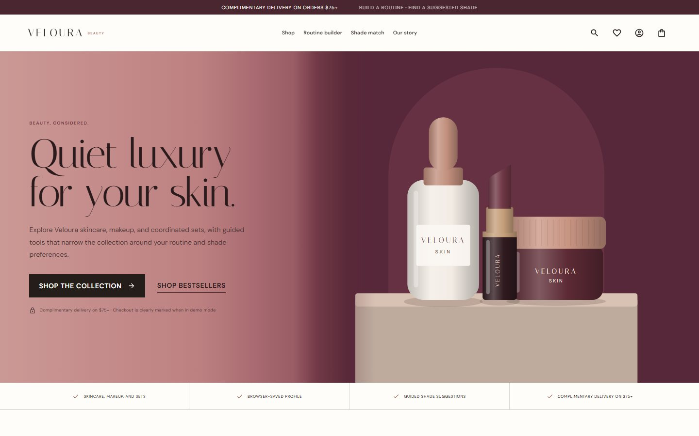
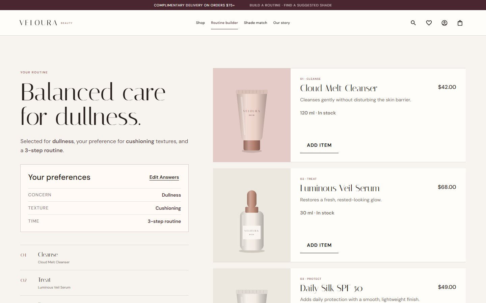
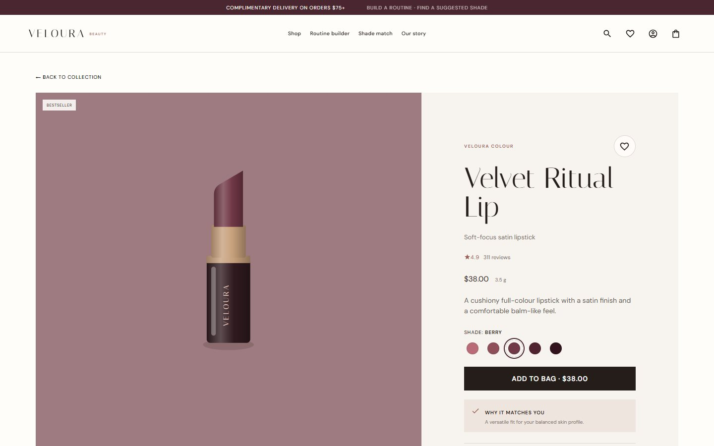
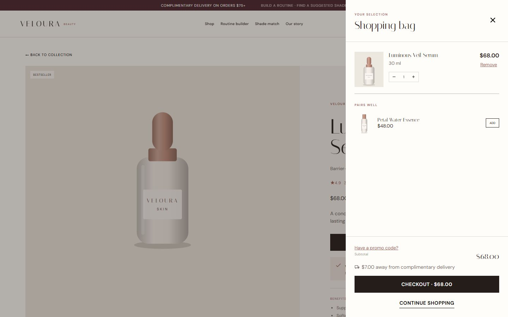
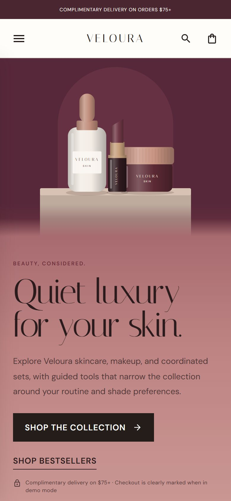

# Veloura Beauty

A beauty e-commerce storefront for a fictional brand, built with React. It covers the full shopping
journey (catalogue, product variants, bag, checkout) plus two guided tools: a routine builder
and a foundation shade finder.

**Live demo:** https://social-media-weld-gamma.vercel.app

> Veloura is not a real company. No real orders or payments are processed; checkout runs in demo
> mode and everything a shopper saves stays in their own browser.



| Routine builder                                  | Product with shade selection                     |
| ------------------------------------------------ | ------------------------------------------------ |
|  |     |
| **Shopping bag**                                 | **Mobile**                                       |
|        |  |

## Features

- **Catalogue**: 18 products across skincare, makeup and sets, with search, concern and price
  filters, and sorting. Filters live in the URL, so a filtered view can be shared or refreshed.
- **Shade variants**: lipsticks, tints, concealers and blushes have selectable shades with their own
  stock; the product illustration and the bag line follow the chosen shade.
- **Bag and checkout**: quantity limits from stock, a promo code (`VELOURA10`), a
  free-delivery threshold, a three-step checkout with browser validation, and an order
  confirmation page that survives a reload.
- **Routine builder**: three questions (concern, texture, time) produce a 2-, 3- or 4-step routine;
  each step can be swapped for an alternative and the whole routine added to the bag.
- **Shade match**: depth and undertone questions suggest a Petal Skin Tint shade, which can be
  saved to the beauty profile.
- **Beauty profile and wishlist**, persisted in `localStorage`.
- **Accessibility**: keyboard-operable dialogs with focus trapping and focus return, labelled
  controls, a skip link, and reduced-motion support.

## Tech stack

React 18 · React Router 6 · Framer Motion · MUI icons · Create React App · Jest and React
Testing Library · ESLint · Prettier · GitHub Actions

## How it is built

```
src/
├── components/
│   ├── layout/          Header, footer, search, route metadata
│   └── product-art/     SVG product illustrations and still-life scenes
├── data/                Product catalogue, merchandising and scene art direction
├── domain/              Framework-free business rules (cart, pricing, selection, wishlist)
├── features/            One folder per journey: products, cart, checkout, routine, shade-match…
├── hooks/               Commerce and customer state, persistence, modal behaviour
├── pages/               Content pages (home, about, policies, 404)
├── repositories/        Access to the catalogue and to browser storage
├── services/            Order creation (demo or hosted checkout)
└── styles/              Global styles split by area
```

Some decisions worth calling out:

- **Business rules are plain functions.** Pricing, cart updates and variant resolution live in
  `src/domain` with their own unit tests, so components stay thin and the rules can move to a
  server later without rewriting the UI. Prices are calculated in whole cents to avoid
  floating-point drift.
- **Product art is generated from data.** Instead of a photo per product and per shade, each
  product declares its packaging type and colours, and `ProductArt` draws it as SVG. A new shade
  is one line of data. Campaign images on the homepage and About page are composed the same way
  (`ProductScene` + `src/data/scenes.js`).
- **State that should be shareable is in the URL** (shop filters, selected shade, order
  confirmation); state that belongs to the shopper is in `localStorage` behind
  `storageRepository`.
- **One hook for every modal surface.** The bag, quick view, filters and mobile menu share
  `useModalDialog` for scroll lock, focus trapping, Escape to close and focus return.
- **Checkout is ready for a real payment provider.** Setting `REACT_APP_CHECKOUT_URL` makes the
  last step post product ids and quantities to a server endpoint that creates a hosted payment
  session; the server, not the browser, decides prices.

## Getting started

Requires Node.js 18 or newer.

```bash
npm install
npm start            # http://localhost:3000
```

| Script                 | What it does                   |
| ---------------------- | ------------------------------ |
| `npm start`            | Development server             |
| `npm run build`        | Production build in `build/`   |
| `npm run test:ci`      | Run the test suite once        |
| `npm run lint`         | ESLint, failing on any warning |
| `npm run format:check` | Verify Prettier formatting     |

Optional environment variables are listed in [`.env.example`](.env.example).

## Testing

Unit tests cover the domain rules (pricing, cart state, variant selection, routine and shade
logic). Integration tests render the real routes and walk through checkout to the confirmation
page, URL-driven filters and the not-found routes. CI runs formatting, lint, tests and a
production build on every push and pull request.

## Roadmap

- Migrate from Create React App to the Next.js App Router (in progress on
  `refactor/phase-2-nextjs`).
- Convert the codebase to TypeScript, starting with the domain layer.

The full plan is in [`docs/refactor-roadmap.md`](docs/refactor-roadmap.md).

## Author

Built by [Maya Chaker](https://github.com/MayaChaker).
